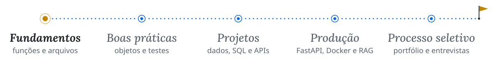

  <picture>
    <source media="(prefers-color-scheme: dark)" srcset="assets/banner_escuro.svg">
    <source media="(prefers-color-scheme: light)" srcset="assets/banner_claro.svg">
    
  </picture>

  
  
  

## Sobre

Estou em transição de carreira para o desenvolvimento **backend com Python e inteligência artificial**. Estudo por uma trilha própria, com um critério simples: um assunto só conta como aprendido quando o código está no GitHub e eu consigo explicar o tema com as minhas palavras. Este perfil registra cada etapa dessa evolução.

<table>
  <tr>
    <td><b>Objetivo</b></td>
    <td>Estágio ou vaga júnior em backend Python com IA</td>
  </tr>
  <tr>
    <td><b>Formação</b></td>
    <td>Análise e Desenvolvimento de Sistemas, em andamento</td>
  </tr>
  <tr>
    <td><b>Fase atual</b></td>
    <td>1 de 5: Fundamentos</td>
  </tr>
  <tr>
    <td><b>Estudando agora</b></td>
    <td>Python: funções <code>lambda</code> e dicas de tipo</td>
  </tr>
</table>

## Tecnologias

  
  
  
  
  

Só entram aqui as tecnologias que já uso na prática. As próximas da trilha são pytest, SQL, FastAPI e Docker.

## Trilha de estudos

A trilha tem cinco fases e 33 tópicos, em três assuntos: Python, IA e Claude.

  <picture>
    <source media="(prefers-color-scheme: dark)" srcset="assets/fase_1_escuro.svg">
    <source media="(prefers-color-scheme: light)" srcset="assets/fase_1_claro.svg">
    
  </picture>

| Etapa | Tópicos concluídos |
| :--- | :--- |
| **Python:** básico | 4 de 6 &nbsp; ■■■□□■ |
| **Python:** intermediário | 0 de 5 &nbsp; □□□□□ |
| **Python:** dados e automação | 0 de 4 &nbsp; □□□□ |
| **Python:** APIs e framework | 0 de 4 &nbsp; □□□□ |
| **IA** | 0 de 8 &nbsp; □□□□□□□□ |
| **Claude** | 0 de 6 &nbsp; □□□□□□ |

Cada quadrado é um tópico: ■ concluído, □ a concluir. Em andamento agora: Funções, Módulos e pacotes e Orientação a objetos.

## Projetos

| Projeto | Sobre |
| :--- | :--- |
| [**Estudos**](https://github.com/CRFjonathas/estudos) Python | Repositório da trilha. Cada tópico começa em uma issue e termina em um pull request |
| [**Super Trunfo**](https://github.com/CRFjonathas/Desafio-Logica-Super-Trunfo-Python) Python | Jogo de cartas no terminal, refatorado de um script procedural para orientação a objetos |
| [**Batalha Naval**](https://github.com/CRFjonathas/Desafio-Batalha-Naval-Python) Python | Tabuleiro em matrizes, com navios na diagonal e ataques em área em forma de cone, cruz e octaedro |
| [**Inventário de sobrevivência**](https://github.com/EstruturaDados/free-fire-CRFjonathas) C | Desafio acadêmico de estruturas de dados, com ordenação, busca binária e contagem de comparações |

## Como eu estudo

- **Prática em toda sessão.** Toda sessão de estudo termina com uma entrega no repositório. Nas sessões de Python, são exercícios em dificuldade crescente, com testes em `pytest`.
- **Fluxo de time.** Uma issue por tópico, uma branch, commits pequenos e um pull request para fechar.
- **IA como tutora, não como atalho.** Uso o Claude para ser questionado, receber pistas e ter o código revisado. Todo o código é escrito por mim.
- **Fixação.** Ao fechar um tópico, escrevo uma nota com as minhas palavras e reviso o conteúdo com cartões de pergunta e resposta.

## Linha do tempo

| Quando | Marco |
| :--- | :--- |
| nov/2026 | Início da trilha de estudos e criação do repositório [estudos](https://github.com/CRFjonathas/estudos) |
| abr/2026 | Super Trunfo refatorado para orientação a objetos e Batalha Naval reescrito em Python |
| nov/2025 | Desafio de estruturas de dados em C, com ordenação e busca binária |

## Contato

Se você procura um estagiário ou desenvolvedor júnior para backend Python, fale comigo pelo [LinkedIn](https://www.linkedin.com/in/jonathasnicacio-dev) ou por [email](mailto:jonathas.github@gmail.com).

Atualizado em novembro de 2026

<!--
COMO ATUALIZAR ESTE README

Ao concluir um tópico
  1. Na tabela da trilha, troque um □ por ■ na linha da etapa e ajuste a contagem ao lado.
  2. Atualize a frase "Em andamento agora" e a linha "Estudando agora" da ficha.
  3. Troque o mês no rodapé.

Ao mudar de fase
  1. Na imagem das fases, troque fase_1 pelo número da nova fase nas três linhas.
     Os arquivos vão de fase_1 a fase_5. No fim, use trilha_concluida.
  2. Atualize o texto alternativo da imagem e a linha "Fase atual" da ficha.
  3. Acrescente uma linha no topo da Linha do tempo.

Ao usar uma tecnologia nova em código publicado
  Copie um selo de Tecnologias e troque o nome e o logo. Exemplo:
  
  O valor de logo é o nome do ícone em simpleicons.org. Os próximos da trilha:
  pytest, ruff, uv, githubactions, pandas, numpy, sqlite, fastapi, docker, scikitlearn, claude.

Ao publicar um projeto da trilha
  1. Acrescente a linha no topo da tabela de Projetos, com o resultado medido.
  2. A partir do segundo projeto publicado, mova a seção Projetos para antes da Trilha de estudos.
  3. Fixe o repositório no perfil.

Na fase 5
  Acrescente no topo os selos de Portfólio e Currículo e crie a versão em inglês.

Para mudar a frase do banner
  Nos arquivos assets/banner_claro.svg e assets/banner_escuro.svg, procure por class="frase" e troque o texto.
-->
